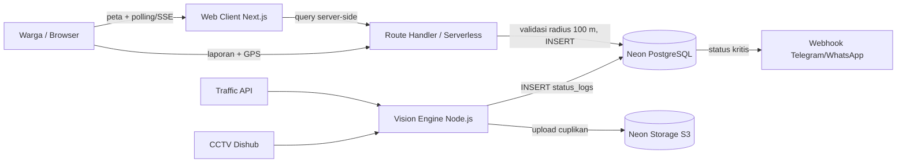

# Arsitektur Sistem

> Status: Draft
> Terakhir diperbarui: 2026-10-14
> Pemilik: satset-dev

## 1. Komponen

| Komponen | Peran |
|---|---|
| Web Client (Next.js) | Peta, pelaporan, polling/SSE status |
| Serverless/Route Handler | Validasi geofence, webhook notifikasi |
| Neon PostgreSQL | Penyimpanan data (koneksi *pooled*) |
| Neon Auth | Autentikasi (jika dibutuhkan) |
| Neon Storage (S3-compatible) | Berkas: cuplikan CCTV, bukti laporan |
| Vision Engine (Node.js/TypeScript) | Ambil Traffic API, olah CCTV, tulis `status_logs` |
| Sumber eksternal | Google/TomTom Traffic API, CCTV Dishub, Telegram/WhatsApp |

## 2. Diagram

## 3. Alur Data

1. Sumber (Traffic API, CCTV, laporan warga) menghasilkan observasi.
2. Observasi ditulis sebagai baris `status_logs` dengan `source` dan `confidence_score`.
3. Klien memperoleh `INSERT` baru lewat polling/SSE dari Route Handler (ADR-006); peta diperbarui. Browser tidak pernah terhubung langsung ke database (ADR-007).
4. Status kritis memicu webhook notifikasi (Phase 4).

## 4. Keputusan Arsitektur

Lihat [11_DECISIONS.md](11_DECISIONS.md).
