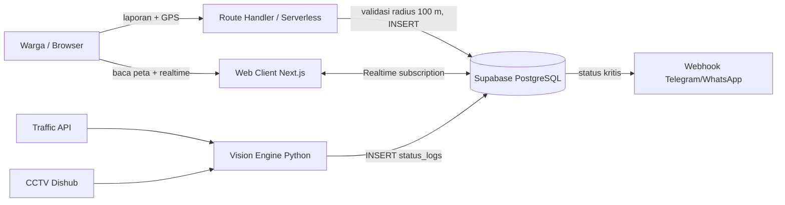

# Arsitektur Sistem

> Status: Draft
> Terakhir diperbarui: 2026-10-14
> Pemilik: satset-dev

## 1. Komponen

| Komponen | Peran |
|---|---|
| Web Client (Next.js) | Peta, pelaporan, langganan realtime |
| Serverless/Route Handler | Validasi geofence, webhook notifikasi |
| Supabase | PostgreSQL, Realtime, (opsional) Auth |
| Vision Engine (Python) | Ambil Traffic API, olah CCTV, tulis `status_logs` |
| Sumber eksternal | Google/TomTom Traffic API, CCTV Dishub, Telegram/WhatsApp |

## 2. Diagram

## 3. Alur Data

1. Sumber (Traffic API, CCTV, laporan warga) menghasilkan observasi.
2. Observasi ditulis sebagai baris `status_logs` dengan `source` dan `confidence_score`.
3. Supabase Realtime mendorong `INSERT` ke klien yang berlangganan; peta diperbarui.
4. Status kritis memicu webhook notifikasi (Phase 4).

## 4. Keputusan Arsitektur

Lihat [11_DECISIONS.md](11_DECISIONS.md).
