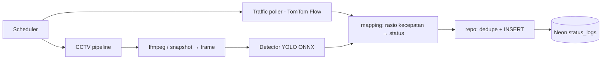

# Vision Engine (Worker Node.js)

> Status: Draft
> Terakhir diperbarui: 2026-10-14
> Pemilik: satset-dev

Worker `vision-engine/` (Node.js >= 20, TypeScript) menulis log status otomatis ke `status_logs`. Keputusan bahasa: [ADR-008](11_DECISIONS.md). Panduan operasional rinci: `vision-engine/README.md`.

## Alur

Worker **tidak** melakukan fusi; tiap sumber menulis log sendiri dan penentuan status akhir dilakukan web-client ([22_CONFIDENCE_ALGORITHM.md](22_CONFIDENCE_ALGORITHM.md)).

## Traffic (FR-008)
- Provider: TomTom Flow Segment Data pada titik lat/lng SPBU. Provider Google belum diimplementasikan.
- `rasio = currentSpeed / freeFlowSpeed`; di atas `TRAFFIC_NORMAL_RATIO` (0,7) → `NORMAL`, di bawahnya atau `roadClosure` → `ANTRE_PANJANG`.
- `KOSONG` **tidak dapat disimpulkan** dari lalu lintas dan tidak pernah dihasilkan worker.
- `confidence_score` = 60% confidence API + 40% jarak rasio dari ambang.
- Dedupe + heartbeat (`DEDUPE_HEARTBEAT_MIN`, 30 menit), konkurensi terbatas, timeout, retry backoff (4xx permanen tidak diulang), kunci API tidak muncul di log. Kegagalan satu SPBU tidak menghentikan siklus. Tanpa `TRAFFIC_API_KEY` mode nonaktif (bukan crash).

## CCTV (FR-009) — opsional dan fail-soft
- Sumber per-SPBU di `cctv-sources.json` (contoh: `cctv-sources.example.json`): snapshot JPEG (fetch) atau HLS/RTSP (ffmpeg, tanpa shell), ROI poligon ternormalisasi, `capacity`.
- Detektor `Detector` pluggable: `OnnxYoloDetector` (onnxruntime-node, model YOLOv8 ONNX, NMS ditulis sendiri; kelas car/motorcycle/bus/truck) dan `StubDetector` untuk uji.
- Jumlah kendaraan dalam ROI ≥ `capacity` → `ANTRE_PANJANG`, selain itu `NORMAL`.
- **Akses CCTV Dishub belum terverifikasi**; model YOLO tidak disimpan di repo (`*.onnx` di-ignore).

## Menjalankan

| Perintah | Fungsi |
|---|---|
| `npm run run:once` | Satu siklus (cocok untuk cron / GitHub Actions) |
| `npm run start` | Loop terjadwal (`TRAFFIC_INTERVAL_SEC` 300, `CCTV_INTERVAL_SEC` 120), SIGTERM rapi |
| `npm run cctv:check` | Periksa ffmpeg, model, dan berkas sumber |
| `npm test` / `npm run test:db` | Uji unit / uji DB nyata (`RUN_DB_TESTS=1`) |

Hosting: workflow `.github/workflows/vision-engine-cron.yml` (tiap 10 menit, `run:once`) cukup untuk Traffic; untuk CCTV disarankan VPS + systemd (`node --import tsx`).

## Status verifikasi

| Item | Status |
|---|---|
| Unit dan integrasi (mock): mapping, geo/ROI, NMS YOLO sintetis, traffic, scheduler | ✅ 39 lulus, 1 dilewati |
| DB Neon nyata: listSpbu, INSERT, hapus | ✅ |
| ffmpeg dengan video sintetis | ✅ |
| TomTom dengan kunci valid | ❌ belum diverifikasi (hanya mock; jaringan terjangkau, kunci palsu → 401) |
| onnxruntime-node dan model YOLO nyata | ❌ unduhan binary gagal di sandbox; diuji dengan sesi palsu |
| CCTV nyata / izin Dishub | ❌ belum |
| Workflow GitHub Actions | ❌ belum dijalankan |

## Keputusan terbuka
Izin dan format akses CCTV; penyedia model YOLO; akun dan kuota TomTom; verifikasi koordinat gerbang SPBU; kalibrasi `TRAFFIC_NORMAL_RATIO` (0,7), `CCTV_QUEUE_THRESHOLD` (8), `roi`/`capacity` per lokasi; pilihan hosting.
